<div align="center">


# Ruchira Edirisinghe · Portfolio

**UI/UX Engineer · Game Developer · Graphic Designer**

A space-themed personal portfolio: case studies, playable browser games, design galleries
and a few 3D surprises, built with Next.js and shipped as a fully static site.

[](https://ruchiraedirisinghe.vercel.app)


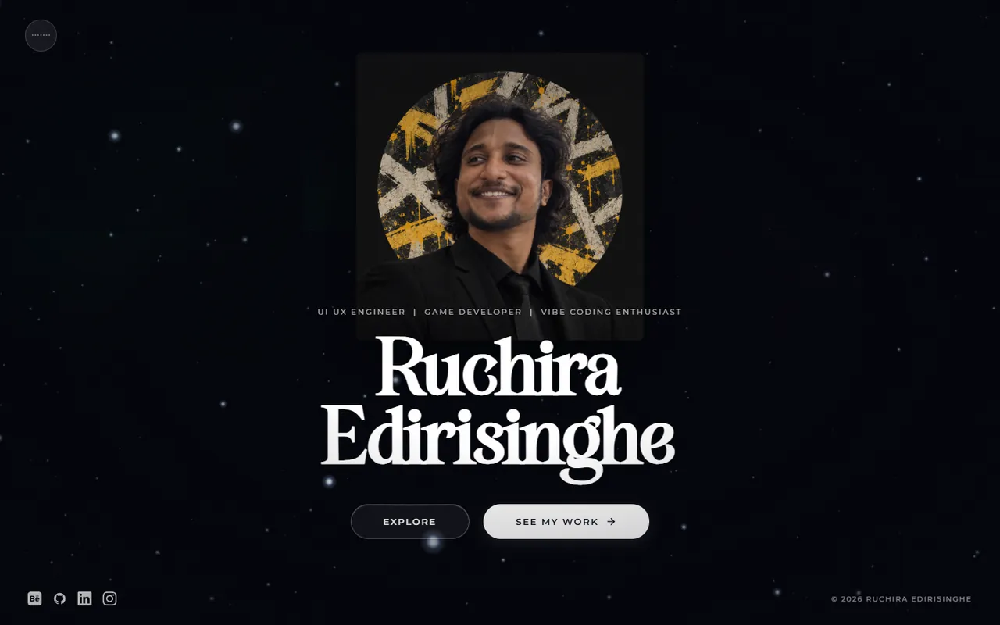

</div>

---

## Contents

- [A quick tour](#a-quick-tour)
- [What's inside](#whats-inside)
- [Built with](#built-with)
- [Run it locally](#run-it-locally)
- [How the project is organised](#how-the-project-is-organised)
- [Performance](#performance)
- [Working with images](#working-with-images)
- [License](#license)

---

## A quick tour

<table>
  <tr>
    <td width="50%">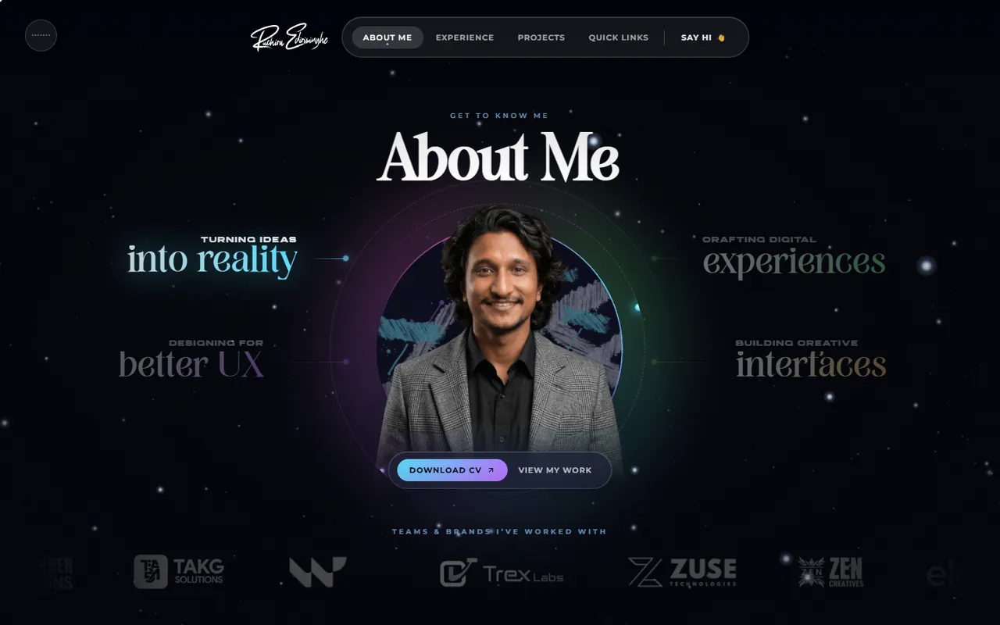<br /><b>About</b>: the story, the skills and the people behind the work.</td>
    <td width="50%">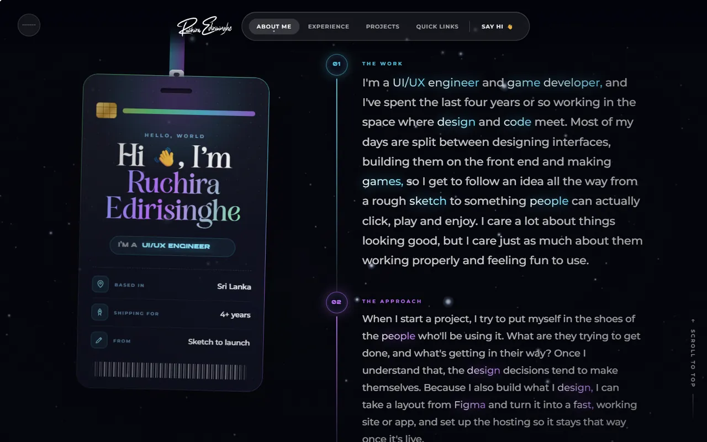<br /><b>The story</b>: a swinging ID badge next to a word-by-word timeline.</td>
  </tr>
  <tr>
    <td>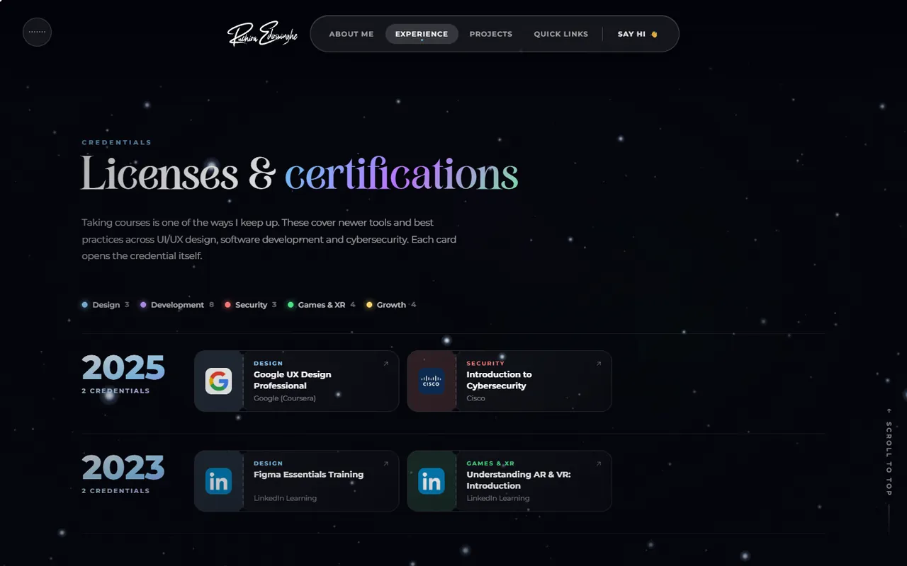<br /><b>Experience</b>: jobs, certifications, skills, education and volunteering.</td>
    <td>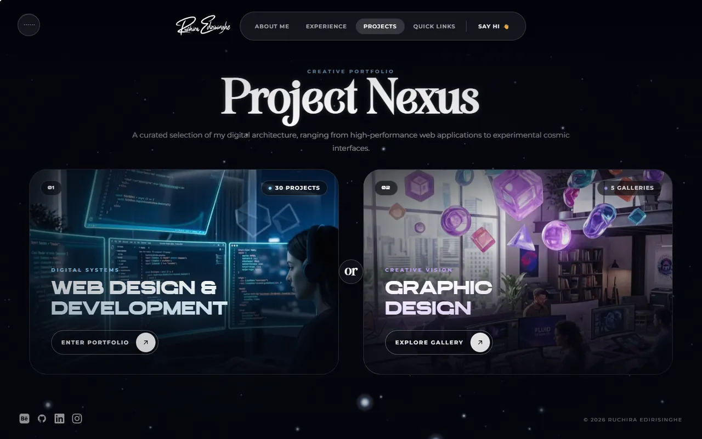<br /><b>Projects hub</b>: pick web &amp; development or graphic design.</td>
  </tr>
  <tr>
    <td>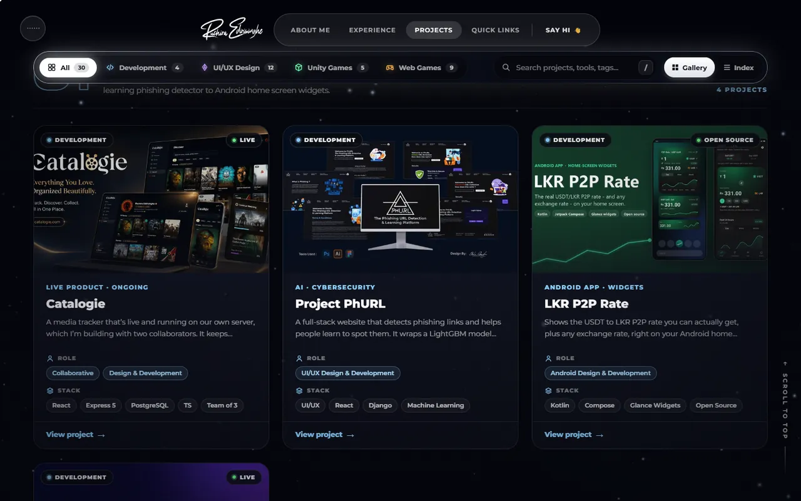<br /><b>Web projects</b>: 30 projects you can filter and search.</td>
    <td>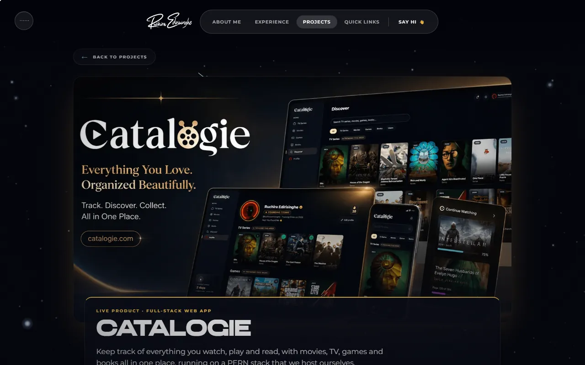<br /><b>Case studies</b>: the problem, the process and the result.</td>
  </tr>
  <tr>
    <td>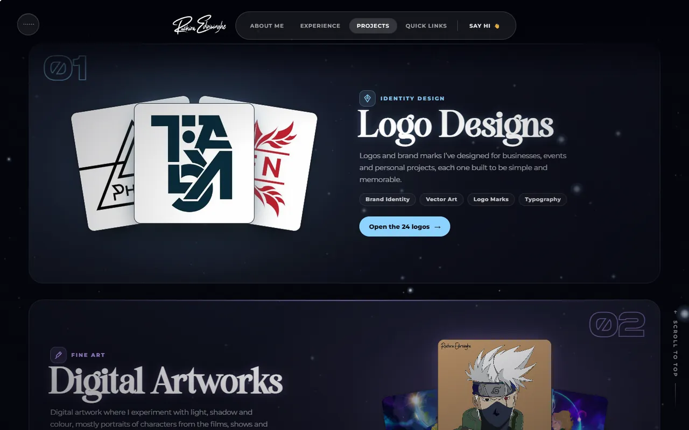<br /><b>Graphic design</b>: 77 pieces in 5 collections.</td>
    <td>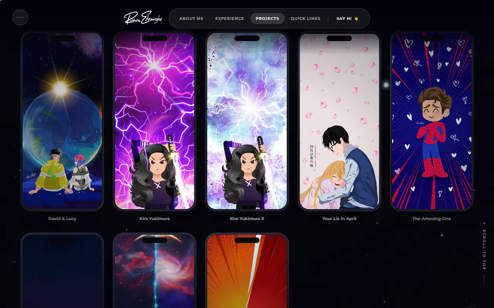<br /><b>Wallpapers</b>: free full-resolution downloads.</td>
  </tr>
  <tr>
    <td>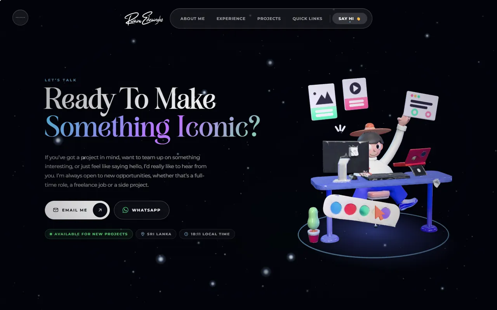<br /><b>Contact</b>: every way to get in touch, plus a 3D desk scene.</td>
    <td>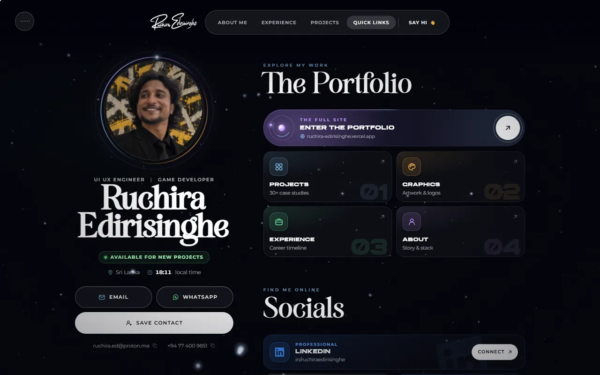<br /><b>Quick links</b>: a link-in-bio page with a "save contact" card.</td>
  </tr>
</table>

### On a phone

Every page is designed for small screens too, down to 320px wide.

<div align="center">
  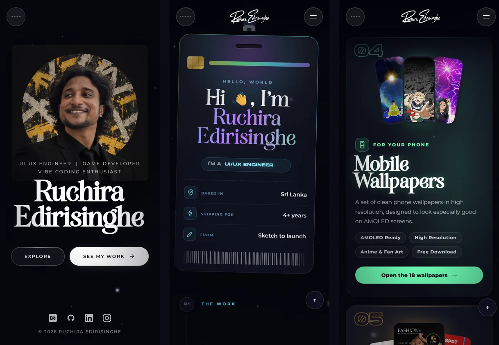
</div>

---

## What's inside

| | Feature | What it does |
|---|---|---|
| 🌌 | **Living starfield** | A three.js star field drifts behind every page, with the odd shooting star. |
| ✍️ | **Signature preloader** | My signature writes itself, then opens out like a portal into the page. |
| 🛸 | **3D figures** | A UFO, an astronaut peeking over the footer and a desk scene, all real-time WebGL. |
| 🎮 | **Playable games** | Nine browser games and five Unity games, each with its own case-study page. |
| 🖼️ | **Galleries & lightbox** | Logos, artworks, posters, wallpapers and more, in a swipeable full-screen viewer. |
| ⬇️ | **Wallpaper & artwork downloads** | A short thank-you card counts down from 3, then the original high-res file downloads. |
| 🎵 | **Ambient music & sound effects** | A space-jazz soundtrack that fades in once you interact, with soft UI sounds. One tap pauses it, and the choice sticks. |
| 🖱️ | **Custom cursor** | A glowing cursor that reacts to links, buttons and popups. |
| 🫧 | **Skills cloud** | Skill bubbles that bounce around with simple physics. |
| 💬 | **Testimonials constellation** | Colleagues as linked stars; pick one to read what they said. |
| 🥚 | **Easter egg** | Hidden on the About page. Have a look around. |
| ♿ | **Accessible by default** | Respects *reduced motion*, keyboard focus states, alt text and screen-reader labels. |

---

## Built with

| Layer | Tools |
|---|---|
| Framework | [Next.js 15](https://nextjs.org) (App Router) with React 19 |
| Language | TypeScript |
| 3D | [three.js](https://threejs.org) |
| Styling | Plain CSS, one stylesheet per page, under `styles/` |
| Icons | [Simple Icons](https://simpleicons.org) and inline SVG |
| Hosting | [Vercel](https://vercel.com), served as static files (security headers in `vercel.json`) |
| Analytics | Vercel Analytics and Speed Insights |

The site **builds to plain HTML, CSS and JavaScript** (`output: 'export'`), so there's no server
to run. The `out/` folder can go on any static host.

---

## Run it locally

You'll need **Node.js 20 or newer**.

```bash
# 1. Get the code
git clone https://github.com/ruchira-edirisinghe/My-Web-Revamp.git
cd My-Web-Revamp

# 2. Install dependencies
npm install

# 3. Start the dev server (with hot reload)
npm run dev
```

Then open **http://localhost:3000**.

| Command | What it does |
|---|---|
| `npm run dev` | Starts the development server with hot reload. |
| `npm run build` | Builds the static site into `out/`. |

> **Tip:** `npm run build` rewrites the `.next` folder. Stop `npm run dev` before you build,
> or the running dev server will break.

---

## How the project is organised

```text
app/                    One folder per page (Next.js App Router)
├─ page.tsx             Home  →  /
├─ about/ experience/ contact/ links/ coming-soon/
└─ projects/            Projects hub  →  /projects
   ├─ web/              Web projects + a case study per project  →  /projects/web/<name>
   └─ graphic/          Graphic design + 5 galleries  →  /projects/graphic/<name>

components/             React components
├─ StandardShell.tsx    Shared frame: navbar, preloader, footer, cursor, music
├─ about/               Sections of the About page
└─ pages/               Page-level components
   ├─ galleries/        Gallery page, lightbox and the gallery data
   ├─ showcase/         Case-study layout and project data
   └─ games/            Game case studies

lib/
├─ scripts/             The animations and 3D scenes (starfield, figures, cursor, music…)
├─ sfx.ts               UI sound effects
├─ pause-offscreen.ts   Pauses animations you can't see
└─ when-idle.ts         Loads heavy 3D scenes when the browser is idle

styles/                 CSS, one file per page
public/                 Images, audio, models and documents that get deployed
assets-src/             Original source images (kept in git, never deployed)
docs/readme/            The screenshots in this README
```

<details>
<summary><b>How the animations hook into React</b></summary>

<br />

Each animation lives in its own module in `lib/scripts/` and exports a function such as
`initAbout()` that starts it and **returns a cleanup function**. A page component calls it
inside `useEffect` and runs the cleanup when the page unmounts:

```tsx
useEffect(() => {
  const stop = initAbout();
  return stop; // canvases, listeners, audio and animation loops are torn down
}, []);
```

That keeps navigation clean: moving between pages never leaves an animation loop or event
listener running in the background, and it's safe under React's Strict Mode.

</details>

---

## Performance

A site full of animation still has to feel smooth on an ordinary laptop or phone. A few
things make that happen:

- **Off-screen pausing.** Sections you've scrolled past stop animating (`lib/pause-offscreen.ts`).
- **GPU-friendly animation.** Movement uses `transform` and `opacity`, which the graphics card
  handles, instead of properties that make the browser repaint the page.
- **Lazy 3D.** WebGL scenes load when you get near them or when the browser is idle, and their
  shaders compile in the background so scrolling doesn't stutter.
- **Low-power GPU.** The starfield asks for the power-saving graphics chip and draws at 30 fps.
- **Lean images.** Everything ships as WebP, with small "card" versions for thumbnails.
- **Reduced motion.** If your device asks for less motion, the site turns the big animations off.

---

## Working with images

<details>
<summary><b>Image formats</b> (and sizes)</summary>

<br />

Everything under `public/Images` ships as **WebP** (quality 85).

- Case-study screenshots are stored up to **1920px** wide. Each one also gets a
  **`<name>-card.webp` at 1100px** for the gallery cards.
- Wallpapers and artworks also keep their **original high-resolution file**
  (`…/original/`). That's what the download button gives you.
- Two things stay PNG on purpose: `Images/favicon/**` (the web manifest expects PNG) and
  `Images/mynew.png` (the social-share image, since some crawlers don't read WebP).

</details>

<details>
<summary><b>Game covers</b> (16:9)</summary>

<br />

All ten games ship `cover.webp` at **1600×900**, `cover-thumb.webp` at **700×394** and
`cover-card.webp` at **1100×619**, matching the 16:9 cards they appear in.

</details>

---

## License

**© 2026 Ruchira Edirisinghe. All rights reserved.**

This code is public so you can see how the site works, not so it can be reused. The code,
design, artwork, music and written content may not be copied, modified or redistributed
without written permission. See [LICENSE](LICENSE) for the full terms.

<div align="center">
<br />

Made with ☕ and a lot of stars in Sri Lanka ·
[Portfolio](https://ruchiraedirisinghe.vercel.app) ·
[LinkedIn](https://www.linkedin.com/in/ruchiraedirisinghe) ·
[Behance](https://www.behance.net/ruchiraedirisinghe) ·
[GitHub](https://github.com/ruchira-edirisinghe)

</div>
